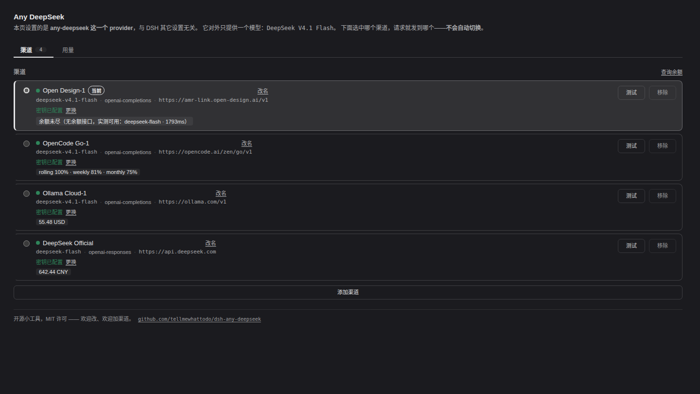
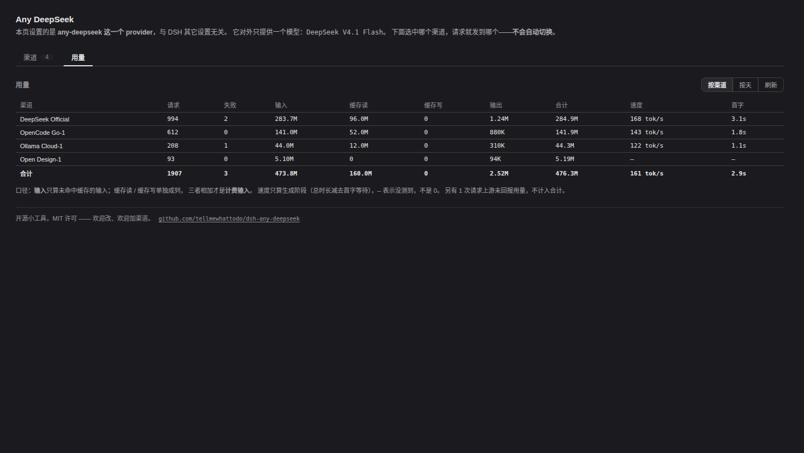

# dsh-any-deepseek

Collapse several DeepSeek relays into **one** provider with **one** model: paste a key per channel
in the settings panel, click to switch.

A small open-source tool (MIT). Fork it, add a relay, improve it — see
[Contributing](#contributing).

[中文](README.md) · English (this page)



---

## What problem this solves

You have DeepSeek credit in several places: the official API, a relay, a cloud vendor, a
colleague's cheap recommendation. In DeepSeek Harness, that would normally become **N entries in
the model picker**, and every switch means editing configuration, changing the model id, changing
the key — plus you have to remember yourself which relay spent how many tokens this month.

After installing this plugin:

- The model picker has **one row**: `any-deepseek / deepseek-v4.1-flash`.
- Any number of **channels** hang off it; each is an endpoint + a key + a display name.
- Click a channel's dot and requests go there. **No automatic switching** (see
  [Why no failover](#why-no-failover)).
- Usage is booked **per real upstream**.

```
                ┌── channel A (official)   ← currently selected
composer ──────►│
  │             ├── channel B (a relay)
  ▼             └── channel C (another)
any-deepseek
  / deepseek-v4.1-flash
   (the only model exposed)
```

## Install

```bash
dsh plugin --profile web add dsh-any-deepseek
```

Then **restart DSH** and open Settings → **Any DeepSeek**.

> **A first install requires a restart**: the profile's layer list changed, and the composition
> graph is built at boot. Editing an already-installed plugin's client half reloads in the
> browser; its node half does not.
>
> `dsh plugin` forwards its arguments to pnpm, so `add <spec>` accepts a registry name, a tarball
> path, or a local directory (installed as a symlink).

## Usage

### Add a channel

Click **添加渠道**. Only two things are required:

| Field | Required | Meaning |
|---|---|---|
| **规格** (preset) | ✅ | Determines endpoint, upstream model id, and protocol — so you don't type them. |
| **渠道 id** (channel id) | ✅ | The configuration key, `[a-z0-9][a-z0-9_-]*`. The same preset can be added twice; the second becomes `-2`. |
| **显示名** (display name) | — | Display only. Tells two accounts on the same relay apart. **Renaming never touches the id.** |
| **密钥** (key) | ✅ | The key itself. There is no name to invent. |

Bundled presets: **DeepSeek Official**, **OpenCode Go**, **Ollama Cloud**, **Open Design**,
**CommandCode**. For another relay, see [Adding a channel](#adding-a-channel).

### Switch channels

Click the dot at the left of a row. The current channel is marked three ways — a colour bar down
the left edge, a stronger border, and a tinted fill — plus `aria-current`.

**Switching invalidates the prompt cache for the running conversation**, so switch at a natural
boundary or start a new session.

### Remaining balance

Click **查询余额** (on demand; nothing is scanned when the panel opens). Four outcomes are kept
strictly apart, because each calls for a different action:

| Shown | Meaning |
|---|---|
| `642.44 CNY` / `55.48 USD` | An amount was read |
| `rolling 100% · weekly 81% · monthly 75%` | This relay reports **usage windows**, not money |
| **余额未尽** (no balance API; verified live: …) | No balance API, but a live request **succeeded** ⇒ the account is not blocked for lack of credit. **Not an amount** (see below) |
| 不支持查询 / 读取失败 / 未配置密钥 | Three different kinds of "nothing" |

> ⚠️ **"Not exhausted" is not "how much is left".** It is the result of one minimal real request
> (a token or two) succeeding, which proves exactly three things: the endpoint is serving, the key
> works, and the account is not blocked for lack of credit (an exhausted account answers
> 402/quota, not 200). So the panel says only 「未尽」 and **never fabricates an amount** —
> printing `0.00` would read as "you are out of credit", the opposite of the truth.

> ⚠️ **A missing number is never rendered as `0`.** "We could not read it" and "it is empty" lead
> to opposite actions.

### Usage



One row per channel, groupable by channel or by day.

**Counting convention** (the panel prints it too): harness token counts are **disjoint** —
**input** is uncached input only, cache reads and writes are separate columns, and the three
together are the **billable input**. Treating "input" as the total makes it look under-reported.

**Speed** counts generation time only (total minus time-to-first-token). Blending queueing +
first-token wait + generation into one number makes "slow to start" and "slow throughout" read
identically, and those two call for opposite fixes. `—` means unmeasured, **not zero**.

## Configuration

Everything lives under one settings namespace — the **profile entry id** from
`cordis.patch.yml`, which is what the panel binds to:

```yaml
dsh-any-deepseek:
  current: opencode-go          # the live channel
  channels:
    opencode-go:
      apiKey: sk-…              # the key itself
    open-design:
      preset: open-design
      label: Open Design (main)  # optional display name
  usage:
    enabled: true
```

`channels.<id>` may be either:

- **preset-backed** — `preset: opencode-go`, plus optional overrides; or
- **fully declared** — `baseURL` + `model` required, `api` defaults to `openai-completions`,
  and `contextWindow` / `maxTokens` fall back to documented defaults (the panel shows ⚠ on the
  row when a default was applied rather than declared).

### Where the key lives (please read this part)

`apiKey` holds the key **itself**, on the channel. The panel never asks you to invent a name for
it — you paste the key and it is written here.

⚠️ **That means the key is in your profile configuration.** `dsh --dump-config` prints patch
layers verbatim and does **not** redact, so a diagnostic dump or a `git diff` of the profile
includes it. **Do not share the profile document.** Environment-variable injection
(`-e SOME_KEY=…`) is not consulted — nothing resolves a name.

> An earlier version hid the key behind a "credential reference name" and told you to set it "in
> the credential centre" — a UI that does not exist. The current design is one field, one store,
> one write.

`apiKeyEnv` is still **read**, for configurations written before this change: when its value
matches the reference-name grammar (`^[A-Za-z_][A-Za-z0-9_]*$`) it is resolved as a name; when it
does not, it cannot be one, so it is adopted as the key itself. `apiKey` always wins when both are
present, so re-entering the key once in the panel migrates an entry.

A channel with no key **still appears** in the panel — that is how you find and fix it. Requests
through it fail with `MISSING_CREDENTIAL`, and its row shows a hollow dot.

### Protocols

`openai-completions` is the default and the recommendation: almost every relay speaks it, it
exposes the largest compatibility surface (~20 switches), and its usage normalization already
reconciles the three cache-token spellings relays use
(`prompt_tokens_details.cached_tokens`, `prompt_cache_hit_tokens`, top-level `cached_tokens`).

Set `api` on one channel only when that relay speaks something else (`openai-responses`,
`anthropic-messages`). The panel never changes protocol behind your back.

### Thinking level

Each channel declares its selectable thinking levels, and the level picked in the harness is
passed through to the relay:

```
harness reasoningEffort → pi-ai ThinkingLevel → model.thinkingLevelMap → wire value
```

**There is no second mapping layer in this plugin**: the `thinkingLevelMap` the transport applies
**is** the mapping, and a second one would drift from it. A level declared `null` is unsupported
and is not offered in the picker.

### Image input

Supported. A channel can send and receive images, which requires declaring `input` with `image` —
during **model registration** (`inputModalities`), not in the request path. This was a real
defect: capability is a property of the provider, not of a channel or a single request.

## Why no failover

v1 is deliberately manual. A failing channel reports its own error; it does not silently fall over
to another:

- Silent failover makes "who answered this?" unknowable, while the usage table honestly records
  the other relay — two parts of the UI would disagree.
- Switching mid-conversation invalidates the prompt cache, costing more than the failure saved.
- Failure is information. Hiding it means you never learn a relay is degrading.

## Adding a channel

This is a **small practical plugin**, and adding a relay is the most valuable contribution —
usually it touches one file.

### Add a preset (the common case)

Edit [`src/presets.ts`](src/presets.ts) and add an entry to `CHANNEL_PRESETS`:

```ts
'your-relay': {
  displayName: 'Your Relay',
  api: 'openai-completions',
  baseURL: 'https://your-relay.example/v1',
  // 🔴 Use THIS relay's spelling. Model ids differ per relay:
  //    deepseek-v4.1-flash / deepseek/deepseek-v4.1-flash / deepseek-flash …
  //    A wrong spelling does not error here — the upstream rejects it on the first request.
  model: 'deepseek-v4.1-flash',
  ...V41_FLASH_CAPS,
  // Optional: does this relay expose a balance surface, and which shape?
  // balance: { shape: 'openai-billing' },
},
```

That is enough — the preset picker gains the entry automatically.

⚠️ **Two rules** (both from real costs):

1. **Do not write "probed live" in a comment unless you actually probed it.** This repo once
   carried a `Probed live: the billing pair answers` comment for a route that had never been
   called; the first real call returned 404. **A false claim is worse than no comment**, because
   it stops the next reader from checking.
2. **`model` is the upstream spelling, not our id.** We expose exactly one id,
   `deepseek-v4.1-flash`; per-relay spellings are absorbed by presets — that is the whole point
   of this plugin.

### Add a balance shape (rarer)

If a relay has a balance API with a new shape, edit [`src/balance.ts`](src/balance.ts): add a
`shape`, add a `parseXxx()`, give it a path in `balanceUrls()`, and dispatch it in `readBalance()`.
`balanceUrls()` is the **only** place that knows the paths, so a preset cannot disagree with the
transport.

### Gates (run before committing)

```bash
pnpm run typecheck     # two tsconfigs: node half + client half
pnpm run test          # pure layers only; no harness needed
pnpm run build         # lib/index.js + lib/client.js
```

Changes must come with a test **that can go red**. The rule in this repo is that **a judgement must
carry weight** — revert the fix and the test must fail; otherwise it is decoration. Every
significant claim in the code carries its negative-control result.

## Known boundaries

- Does not modify the harness, and does not replace `deepseek-official` / `llm-pi-ai` routes.
- Exposes exactly one model id. Upstream ids differ per relay and are mapped in presets.
- **No cost estimation** (there is no price table).
- **No automatic failover** (v1, see above).
- **No multi-model aggregation** — this is "one model, many sources", not a model router.

## Contributing

Fork, file an issue, send a PR. Especially welcome:

- **Add a relay** — one file, see above.
- **Fix a sentence** — every line in the panel is supposed to be a verifiable fact. If one is
  vague or stale, change it.
- **Report "installed but nothing happens"** — silent failure is the most expensive class of bug
  in this project, and a reproduction is worth more than any guess.

Source: <https://github.com/tellmewhattodo/dsh-any-deepseek>

## License

MIT
