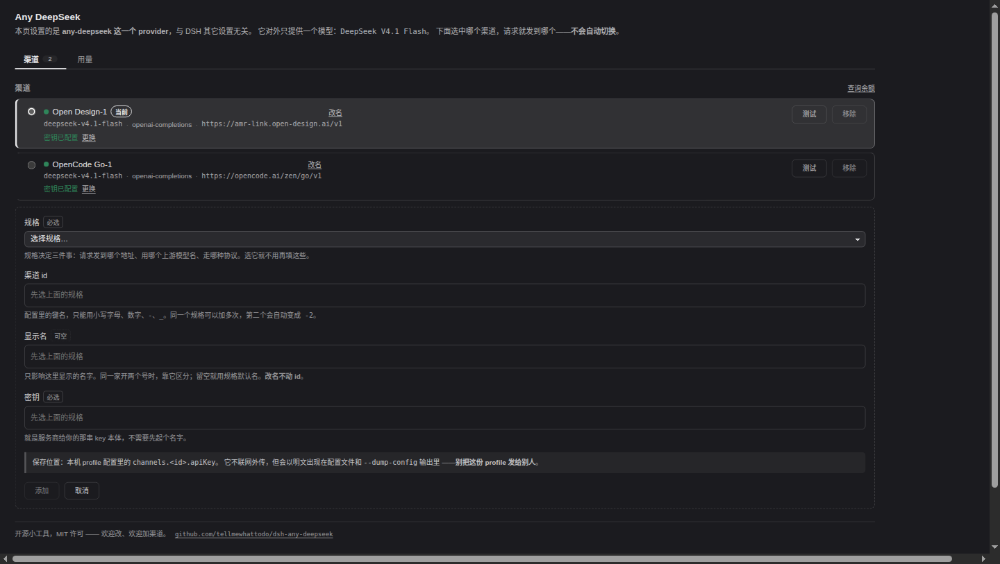

# dsh-any-deepseek

**在 DeepSeek Harness 里，用多家渠道的 DeepSeek 额度，而模型列表里只多出一行。**

你在好几处买过 DeepSeek 的额度：官方、某家中转、某个云厂商、朋友推荐的便宜渠道。
这个插件把它们收进**一个** provider，你粘几个 key、点一下就能换 —— 同时按真实渠道分开记账，
你知道这个月每一家各花了多少 token。


[English](README.en.md) · 中文（本页）

---

## 装之前先看一眼：它适合你吗

**适合**，如果你符合下面任意一条：

- 你有**不止一个** DeepSeek 渠道，并且想在 Harness 里随意切换而不用改配置。
- 你想要**按渠道分开的用量统计**，而不是所有请求混成一个总数。
- 你用中转站，而它们的模型名各不相同（`deepseek-v4.1-flash` / `deepseek/deepseek-v4.1-flash` /
  `deepseek-flash`），懒得每次自己对应。

**不适合**，如果：

- 你只有一个渠道，且它就是官方 —— Harness 自带的 `deepseek-official` 已经够用，不必装。
- 你想要**自动故障转移**（一家挂了自动换下一家）。本插件 v1 不做，见 [为什么不做自动切换](#为什么不做自动切换)。
- 你想要**多模型切换**。这个插件是「一个模型、多个来源」，不是模型路由器。

## 安装

需要已经装好 DeepSeek Harness。在终端执行：

```bash
dsh plugin --profile web add dsh-any-deepseek
```

然后**重启 DSH**，打开 设置 → **Any DeepSeek**。

> **为什么必须重启**：插件被加进了 profile 的加载列表，而这份列表只在 DSH 启动时读取。
> 之后改这个插件的界面部分只需刷新浏览器，但**第一次装**一定要重启。

## 第一次用：三步

### 第 1 步：加一个渠道

点 **添加渠道**，填两个必填项就能用：



| 填什么 | 说明 |
|---|---|
| **规格** | 选你用的那家。它决定地址、模型名、协议，所以这三样你不用管。 |
| **密钥** | 那家给你的 key，直接粘。不需要先起名字。 |

**渠道 id** 会自动填好（可以改，只是配置里的键名）。**显示名**留空的话用规格的默认名 ——
同一家开两个号时，填上「主号」「备号」之类会好认。

内置规格：DeepSeek Official、OpenCode Go、Ollama Cloud、Open Design、CommandCode
（这些名字与下拉框里显示的完全一致）。
要接别家，见 [接一个新渠道](#接一个新渠道)。

### 第 2 步：确认它选中了

第一个加进去的渠道会**自动成为当前渠道**，行首有圆点、左侧有色条、右侧有「当前」标记。

以后想换：点那一行左边的圆点即可。

### 第 3 步：开始用

在模型的对话界面里选模型，选 **DeepSeek V4.1 Flash**（provider 名是 `any-deepseek`）。
之后所有请求都会发到你选中的那个渠道。

## 日常会用到的三件事

### 换一个渠道

点行首的圆点。

> ⚠️ **换渠道会让当前对话的 prompt 缓存失效**，所以尽量在话题切换时换，或者干脆新开一个会话。

### 看还剩多少钱

点 **查询余额**。它不会在打开面板时自动跑 —— 因为每次都要请求每一家的服务器。

不同家能给出的东西不一样，面板会如实区分：

| 你看到的 | 意思 |
|---|---|
| `642.44 CNY`、`55.48 USD` | 这家能报金额 |
| `rolling 100% · weekly 81% · monthly 75%` | 这家只给**订阅用量百分比**，不给钱 |
| **余额未尽**（实测可用：…） | 这家**没有余额接口**，但我发了一次最小请求，**它答了** ⇒ 账户没停 |
| 不支持查询 / 读取失败 / 未配置密钥 | 三种不同的「没拿到」 |

> **「余额未尽」不等于「还剩多少」。** 一次成功的请求只证明三件事：地址通、key 对、账户没因为欠费被拒
> （欠费的账户会回 402，不会回 200）。所以这里只写「未尽」，**不会编一个金额给你**。

### 看这个月花了多少

切到 **用量** 分页。


可以按渠道看，也可以按天看。「输入」只算没命中缓存的部分，缓存读/写单独列出 ——
三者相加才是计费输入。速度一栏的 `—` 表示没测到，**不是 0**。

## 我的 key 安全吗

**它存在你本机的配置文件里，明文。**

位置是 profile 的 `channels.<渠道id>.apiKey`。它不会被这个插件发到任何第三方，
但是：

> ⚠️ `dsh --dump-config` 会把配置原样打印出来、**不做脱敏**。所以：
> **别把 profile 配置文件发给别人**，也别把它的 `git diff` 贴到公开的地方。

如果你需要分享配置做排查，先把 `apiKey` 那几行删掉。

## 出问题了

**模型列表里没有 DeepSeek V4.1 Flash。**
→ 装完还没重启。重启 DSH。

**设置里找不到「Any DeepSeek」。**
→ 同上；或确认装的是 `web` 这个 profile：`dsh plugin --profile web list`。

**报 `MISSING_CREDENTIAL`。**
→ 这个渠道还没填 key。面板里那一行的状态点是空心的，点「填写密钥」补上。

**报 `NO_CHANNEL_SELECTED`。**
→ 一个渠道都没选中。面板底部会有提示，点任意一行的圆点即可。

**「查询余额」显示「读取失败」。**
→ 这家服务器这会儿没答好，稍后再试。如果一直这样，可能是网络到不了它。

**报 401 / 403 / 余额不足。**
→ key 不对或过期，或者那家账户真的没钱了。

**换渠道以后回答变慢/变差。**
→ 不同家的模型行为不完全一样。用「测试」按钮逐家试，用「用量」分页看各家的速度。

## 为什么不做自动切换

一个渠道失败就**报它自己的错**，不会静默换到另一家。三个理由：

- 静默切换会让「这次答案是谁给的」变得不可知，而用量表会照实记另一家 —— 两处对不上。
- 半路换渠道会让 prompt 缓存失效，成本比你省下的那次失败更高。
- 失败是信息。藏起来，你就不知道某家正在坏掉。

## 接一个新渠道

内置了 5 家，接别家通常只需要改一个文件。见 **[CONTRIBUTING.md](CONTRIBUTING.md)**。

## 配置参考（进阶）

设置都在 `dsh-any-deepseek` 这个命名空间下：

```yaml
dsh-any-deepseek:
  current: opencode-go          # 当前渠道
  channels:
    opencode-go:
      apiKey: sk-…              # key 本体
    open-design:
      preset: open-design       # 用内置规格
      label: Open Design（主号）  # 可选，显示名
    my-relay:
      baseURL: https://relay.example/v1   # 或者完全手写
      model: deepseek-v4.1-flash
      apiKey: sk-…
  usage:
    enabled: true
```

**协议**：默认 `openai-completions`（几乎所有中转都说它）。只有当某家真的说别的协议时，
在**那一个**渠道上设 `api: openai-responses` 或 `api: anthropic-messages`。

**思考强度**：每个渠道声明自己支持哪些档位，你在界面上选哪档就传到哪档。
声明成不支持的档位不会出现在选择器里。

**图片**：支持收发图片。

**兼容旧配置**：早期版本把 key 存在 `apiKeyEnv` 里。这个字段仍会被读：
值像环境变量名就当名字解析，不像就直接当 key 用。`apiKey` 存在时永远优先 ——
所以在面板里重填一次 key 就迁移完了。

## 边界

- 不修改 Harness 本体，也不替代自带的 `deepseek-official` 路由。
- 只暴露一个模型 id（`deepseek-v4.1-flash`）；各家的上游模型名由规格映射。
- **不做费用估算** —— 没有价目表，只有 token 数。
- **不做自动故障转移**（v1）。
- **不做多模型聚合**。

## 许可

MIT。这是个实用小工具，欢迎 fork、提 issue、发 PR —— 见 [CONTRIBUTING.md](CONTRIBUTING.md)。

<https://github.com/tellmewhattodo/dsh-any-deepseek>
